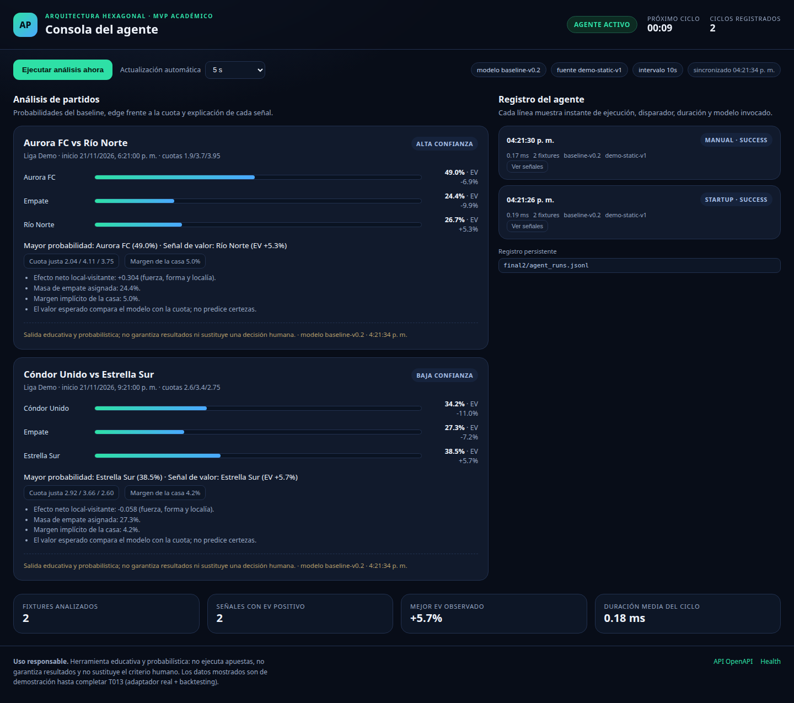

# Agente Persistente — Sports Prediction Assistant

Agente académico que analiza eventos deportivos de forma periódica y publica probabilidades explicables con su justificación, su fuente y su hora de cálculo. Incluye una consola web donde se ve el runtime en ejecución y el registro auditable de cada ciclo.

> **Advertencia.** Herramienta educativa y probabilística. No ejecuta apuestas, no garantiza resultados y no sustituye el criterio humano. Los datos actuales son de demostración.

## Inicio rápido

Requiere Python 3.11 o superior.

```bash
python -m venv .venv
source .venv/bin/activate        # Windows PowerShell: .\.venv\Scripts\Activate.ps1
python -m pip install --upgrade pip
pip install -e ".[dev]"
python -m uvicorn app.main:app --reload
```

| URL | Contenido |
|---|---|
| `http://127.0.0.1:8000` | Consola del agente |
| `http://127.0.0.1:8000/docs` | OpenAPI interactivo |
| `http://127.0.0.1:8000/health` | Estado del servicio |

## Consola del agente



La cabecera muestra si el temporizador está corriendo, la cuenta regresiva al próximo ciclo y el total de ejecuciones registradas. Cada tarjeta compara la probabilidad del modelo con la cuota del mercado e incluye cuota justa, margen de la casa y explicación. La columna derecha es el registro auditable: hora, disparador (`startup`, `schedule` o `manual`), duración, versión del modelo y fuente.

Para regenerar esta captura con un servidor en ejecución:

```bash
/usr/bin/python3 tools/capture_console.py http://127.0.0.1:8000 docs/assets/console-agente.png
```

El agente se autodispara al iniciar y después cada `AGENT_INTERVAL_SECONDS` (por defecto 600). Puedes forzar un ciclo desde la consola o con:

```bash
curl -X POST http://127.0.0.1:8000/api/v1/agent/runs \
  -H 'Content-Type: application/json' -d '{"trigger":"manual"}'
```

## Configuración

Copiar `.env.example` a `.env` si quieres ajustar el runtime.

| Variable | Por defecto | Función |
|---|---|---|
| `AGENT_ENABLED` | `true` | Activa o pausa el ciclo automático |
| `AGENT_INTERVAL_SECONDS` | `600` | Segundos entre ciclos (mínimo 5) |
| `AGENT_STARTUP_RUN` | `true` | Ejecuta un ciclo al arrancar el servidor |
| `RUNS_FILE` | `data/agent_runs.jsonl` | Registro auditable de ejecuciones |

## Arquitectura hexagonal

```text
app/
├── domain/          Entidades (Fixture, Prediction, AgentRun) y reglas (PredictionEngine)
├── application/
│   ├── ports/       Contratos inbound y outbound
│   └── use_cases/   ListFixtures, PredictFixture, RunAnalysisCycle, ListAgentRuns, GetAgentStatus
├── adapters/
│   ├── inbound/     http.py (FastAPI) y timer_scheduler.py (ciclo periódico)
│   └── outbound/    demo_sports_data.py, filesystem_run_repository.py, in_memory_run_repository.py
├── bootstrap.py     Composition root: ensambla dependencias y el lifespan
├── settings.py      Configuración desde variables de entorno
└── main.py          Punto de entrada del servidor
frontend/            Consola HTML/CSS/JS sin dependencias externas
specs/<id>/          spec.md, plan.md y tasks.md por incremento
docs/                Contexto, arquitectura, runtime, operación, skills y tools
tests/               Pruebas de dominio, casos de uso, adaptadores y API
```

Reglas de dependencia: el dominio no conoce infraestructura; los casos de uso dependen solo de puertos; los adaptadores implementan los puertos; `bootstrap.py` es el único lugar que conoce las implementaciones concretas.

## El modelo actual

`PredictionEngine` (`baseline-v0.2`) calcula un efecto neto a partir de fuerza, forma y localía, lo traduce con una logística y asigna una masa de empate dentro de una banda realista (16 %–32 %). Además de las probabilidades 1X2 devuelve probabilidad implícita del mercado, margen de la casa, cuota justa, edge y valor esperado. Si el modelo difiere del mercado en 15 puntos o más, baja la confianza a “muy baja” y muestra un aviso: normalmente eso indica datos sospechosos, no una oportunidad.

La redacción separa dos ideas distintas: **mayor probabilidad** (favorito) y **señal de valor** (mejor EV). Que un equipo sea favorito no significa que tenga valor en su cuota.

## API

- `GET /health`
- `GET /api/v1/fixtures`
- `GET /api/v1/predictions/{fixture_id}`
- `GET /api/v1/agent/status`
- `GET /api/v1/agent/runs?limit=20`
- `POST /api/v1/agent/runs` con `{"trigger":"manual|schedule|startup"}`

## Calidad

```bash
pytest -q
ruff check .
```

GitHub Actions ejecuta lint y pruebas en cada push y pull request a `main`. Las pruebas no dependen de red, de disco permanente ni de esperas reales: el temporizador se desactiva en `tests/conftest.py` y el registro se redirige a un directorio temporal.

## Método de trabajo

Cada incremento abre `specs/<id>/` con `spec.md` (qué y por qué), `plan.md` (cómo, en fases) y `tasks.md` (backlog con estado). `docs/context.md` conserva decisiones, defectos encontrados y el siguiente paso recomendado entre sesiones. Un bug corregido se acompaña de una prueba de regresión que impida que vuelva a aparecer.

## Hoja de ruta

1. **T013** Adaptador de datos reales detrás de `SportsDataPort`, con licencia, límites de uso y hora de captura.
2. **T014** Backtesting con snapshots históricos sin fuga temporal.
3. **C-19** Métricas de calibración por corrida: Brier score y log loss.
4. **C-18** Migrar el registro a SQLite manteniendo el mismo `RunRepositoryPort`.
5. **C-20** Actualización de la consola por SSE o WebSocket.

## Documentación

- [Especificación del MVP](specs/001-mvp/spec.md)
- [Especificación del runtime y la consola](specs/002-agent-console/spec.md)
- [Arquitectura hexagonal](docs/hexagonal-architecture.md)
- [Runtime y consola](docs/agent-runtime.md)
- [Contexto persistente](docs/context.md)
- [Skills y tools](docs/skills-and-tools.md)
- [Operación y recomendaciones](docs/operations.md)
